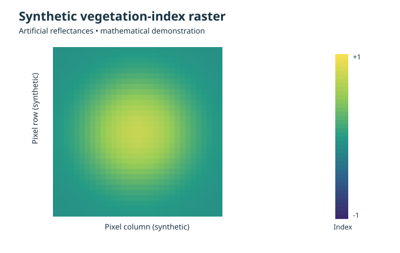
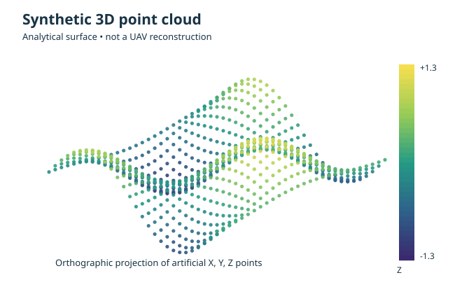

# CocoaTwin-UQ | Public research portfolio

**Valère ALLECHI — MSc candidate in Remote Sensing and GIS**  
CURAT (Centre Universitaire de Recherche et d’Application en Télédétection), Université Félix Houphouët-Boigny, Côte d’Ivoire. Expected MSc completion: July 2027.

## Research interests

Earth observation, geospatial AI, environmental monitoring, spatial data science and UAV photogrammetry. My ongoing master's research concerns tropical agroforestry and carbon monitoring. I am preparing for doctoral research and developing my Python programming and scientific English skills, including preparation for the TOEFL iBT and a Python programming certification.

## Technical demonstrations

This independent public portfolio contains reproducible technical examples built entirely from artificial mathematical inputs. They illustrate workflows, not empirical research findings or independently verified proficiency.

| Example | Demonstrated concepts | Preview |
| --- | --- | --- |
| Synthetic spectral raster | NumPy arrays, normalized difference, invalid-pixel masking, visualization | [Illustration](outputs/synthetic_spectral.svg) |
| Synthetic 3D surface | Coordinate grids, mathematical surface generation, point-cloud visualization | [Illustration](outputs/synthetic_surface.svg) |





## Reproduce

Python 3.11+ recommended. From the repository root:

```bash
python -m venv .venv
# Activate the environment for your operating system
python -m pip install -r requirements.txt
python -m examples.spectral_demo
python -m examples.surface_demo
python -m unittest discover -s tests -v
```

The Python examples generate PNG visualizations locally. The committed SVG previews illustrate the same synthetic mathematical functions.

## Research confidentiality

All demonstration inputs and outputs are synthetic. The 3D example is a mathematical surface, not a UAV reconstruction. No real field observations, geolocations, unpublished results, manuscript, research-specific algorithms or private research history are included. Ongoing research materials are maintained separately and may only be shared following appropriate permission and review. A manuscript is in preparation; no submission or acceptance is claimed.

This repository is a technical learning portfolio, not an open release of the underlying master's research. No licence is granted by this README.
